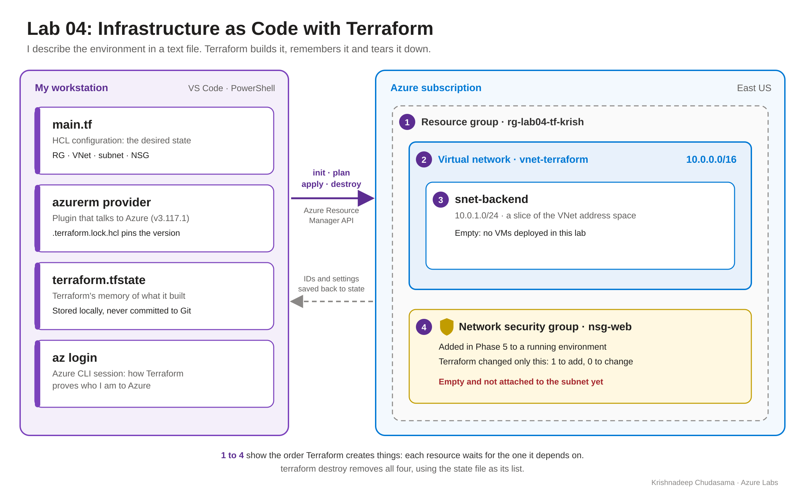
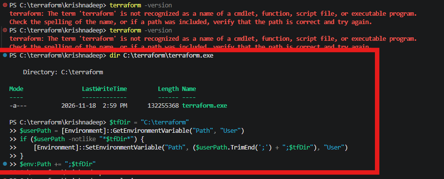
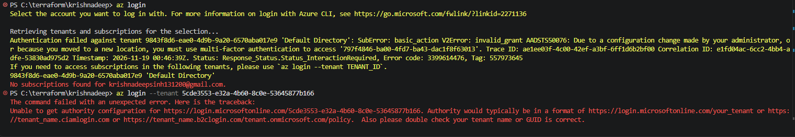
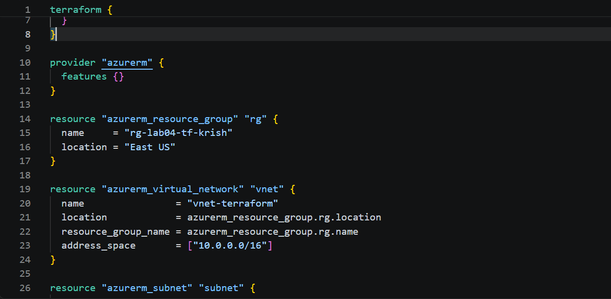
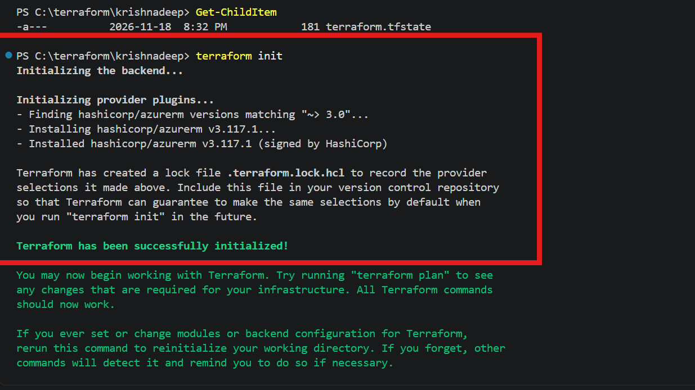
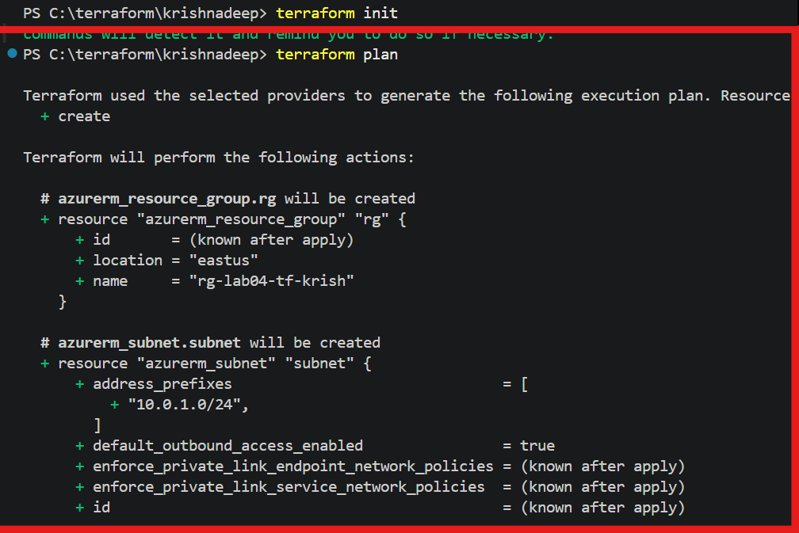
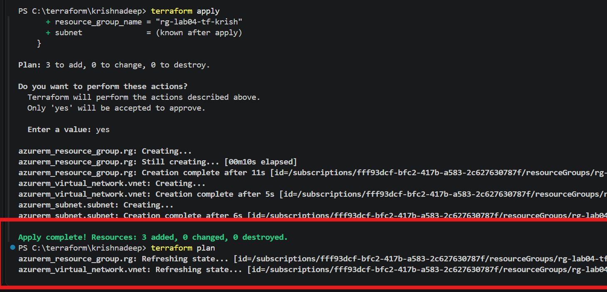
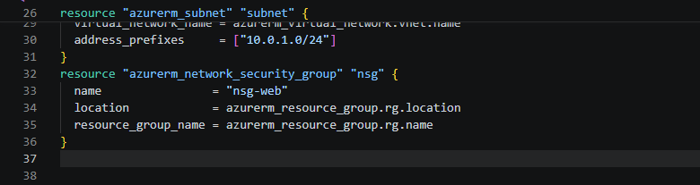
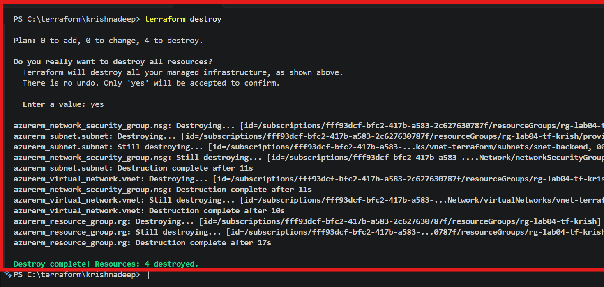
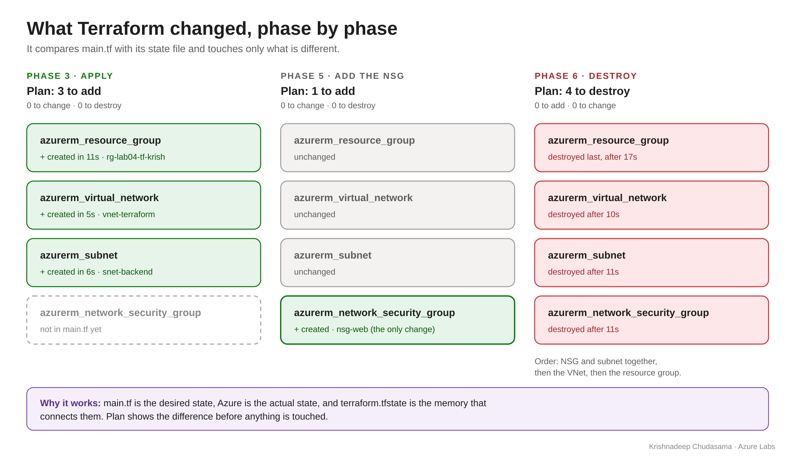

# ☁️ Lab 04: Infrastructure as Code with Terraform
 


 
**Author:** Krishnadeep Chudasama · **Difficulty:** Beginner · **Tooling:** Terraform (azurerm v3.117.1), VS Code, PowerShell on Windows
 
🎥 **WATCH ME COMPLETE THIS LAB HERE:**
 
https://www.loom.com/share/4c35510d4a2f4b1ca1498fbfcb8cb278


## 📋 Table of Contents
- [Objective](#-objective)
- [Architecture Diagram](#-architecture-diagram)
- [Prerequisites](#-prerequisites)
- [Lab Variables](#-lab-variables)
- [Step-by-Step Instructions](#-step-by-step-instructions)
  - [Phase 1: Set Up Terraform and Sign In to Azure](#phase-1-set-up-terraform-and-sign-in-to-azure)
  - [Phase 2: Write main.tf and Initialize](#phase-2-write-maintf-and-initialize)
  - [Phase 3: Plan and Apply](#phase-3-plan-and-apply)
  - [Phase 4: Verify in the Portal](#phase-4-verify-in-the-portal)
  - [Phase 5: Change a Running Environment](#phase-5-change-a-running-environment)
  - [Phase 6: Destroy](#phase-6-destroy)
- [Security Notes](#-security-notes)
- [Troubleshooting](#-troubleshooting)
- [Clean Up Resources](#-clean-up-resources)
---
 
## 🎯 Objective
In this lab, you will describe an Azure network in a single text file and let Terraform build it. You will create a resource group, a virtual network and a subnet from `main.tf`, preview the change with `terraform plan`, build it with `terraform apply`, add a network security group by editing one block, and remove everything with `terraform destroy`. The point of Infrastructure as Code is that the environment becomes a file you can version, review, repeat and throw away, instead of a series of portal clicks nobody can audit.
 
## 🏗️ Architecture Diagram
 

 
**How to read it:** `main.tf` on my workstation is the **desired state**. Azure is the **actual state**. `terraform.tfstate` is Terraform's **memory**, linking the two. Terraform calls the Azure Resource Manager API to build what the file describes, then records the result back in state. Numbers 1 to 4 show the creation order: each resource waits for the one it depends on.
 
## ✅ Prerequisites
- [x] Active Azure Subscription
- [x] [Terraform](https://developer.hashicorp.com/terraform/install) installed and on your PATH
- [x] [Azure CLI](https://learn.microsoft.com/cli/azure/install-azure-cli) signed in with `az login`
- [x] VS Code (any editor works)
## ⚙️ Lab Variables (Naming Convention)
* **Resource Group:** `rg-lab04-tf-krish` (East US)
* **VNet Name:** `vnet-terraform` (`10.0.0.0/16`)
* **Subnet:** `snet-backend` (`10.0.1.0/24`)
* **NSG (added in Phase 5):** `nsg-web`
* **Provider:** `hashicorp/azurerm`, version `~> 3.0` (resolved to v3.117.1)
---
 
## 🚀 Step-by-Step Instructions
 
### Phase 1: Set Up Terraform and Sign In to Azure
I ran Terraform locally instead of in Cloud Shell, so I had to set it up myself and hit two real problems.
 
**Problem 1: `terraform` was not recognized.** I added its folder to PATH from PowerShell, then reopened the terminal:
 

 
**Problem 2: `az login` failed.** Sign-in returned `AADSTS50076` (multi-factor authentication required), and retrying with `--tenant` failed with an authority configuration error. Authentication has to work before Terraform can do anything.
 

 
### Phase 2: Write main.tf and Initialize
1. Create a working folder and a file named `main.tf`.
2. Add the provider block, then the resource group, virtual network and subnet (the full file is in this repo as [`main.tf`](main.tf)).

 
Notice that the VNet and subnet reference the resource group (`azurerm_resource_group.rg.name`). Those references are how Terraform learns the build order, so the order of blocks in the file does not matter.
 
3. Run:
```powershell
terraform init
```
This downloads the azurerm provider and writes `.terraform.lock.hcl`, which pins the exact version.
 

 
`~> 3.0` means any 3.x release but never 4.0.
 
### Phase 3: Plan and Apply
1. Preview first. This is read-only and changes nothing:
```powershell
terraform plan
```

 
2. Build it:
```powershell
terraform apply
```
Type the full word `yes` to confirm. Terraform created the resource group in 11s, the virtual network in 5s and the subnet in 6s: `Apply complete! Resources: 3 added`.
 

 
### Phase 4: Verify in the Portal
1. In the Azure portal, open **Resource Groups** -> `rg-lab04-tf-krish`.
2. You should see the virtual network `vnet-terraform`. Open it and, under **Subnets**, confirm `snet-backend` (`10.0.1.0/24`).
A subnet lives inside its VNet, so it is not listed as a separate resource in the resource group. Terraform still tracks it as its own resource in state.
 
### Phase 5: Change a Running Environment
Add a network security group to `main.tf` and run Terraform again:
 

 
```powershell
terraform plan
terraform apply
```
Terraform compares the file to state, sees one difference and plans to add only `nsg-web`. The resource group, VNet and subnet are left alone. I describe the end result and Terraform works out the steps.
 
> The NSG in this lab is empty and **not associated with the subnet**, so it protects nothing yet. It exists to demonstrate an in-place change.
 
### Phase 6: Destroy
```powershell
terraform destroy
```
Type `yes`. Terraform removed all four resources in dependency order: NSG (11s) and subnet (11s) together, then the VNet (10s), then the resource group (17s).
 

 
Always destroy with Terraform instead of deleting in the portal, so the state file stays in sync with reality.
 
### What changed at each phase
 

 
---
 
## 🔐 Security Notes
Things worth knowing before you treat this setup as production-ready:
 
- **Never commit state.** `terraform.tfstate`, its backups and the `.terraform/` folder can contain sensitive values. The included `.gitignore` excludes them. **Do** commit `.terraform.lock.hcl`.
- **Local state is a single point of failure.** Lose the laptop, lose the memory of what Terraform built. For real work, use remote state in Azure Storage with locking.
- **The NSG protects nothing yet.** An NSG does nothing until it is associated with a subnet or network interface and given rules.
- **Personal logins do not belong in pipelines.** For CI, authenticate with OIDC or a managed identity rather than your own `az login`.
- **Pin your provider.** `~> 3.0` keeps you on 3.x. Test before upgrading to azurerm 4.x.
---
 
 
## 🧹 Clean Up Resources
*Important: Always clean up unused resources.*
 
1. From the folder containing `main.tf`, run `terraform destroy` and type `yes`.
2. Confirm in the portal that `rg-lab04-tf-krish` no longer appears under **Resource Groups**. If it does, wait 30 seconds and refresh.
 
